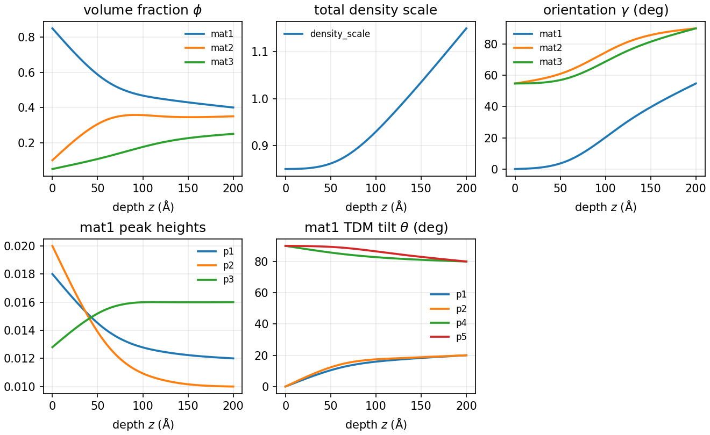
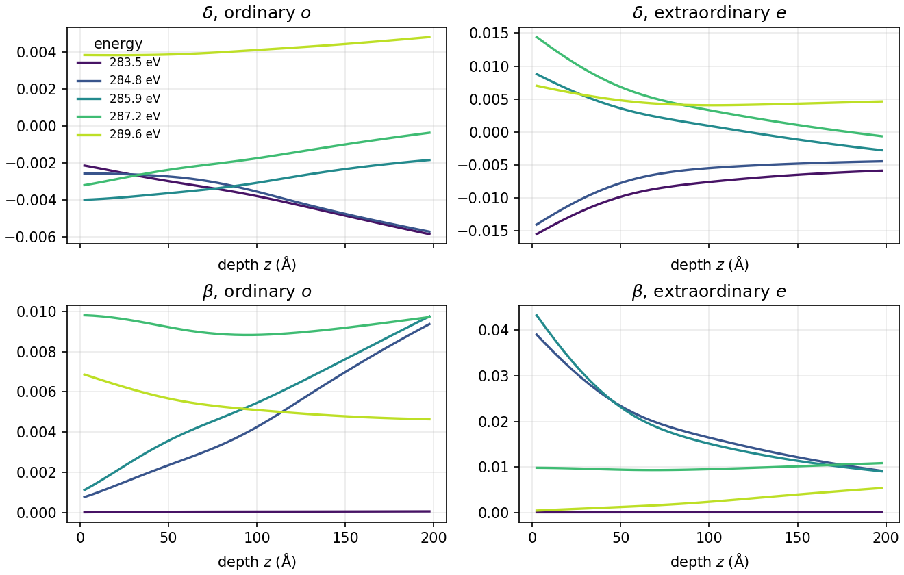
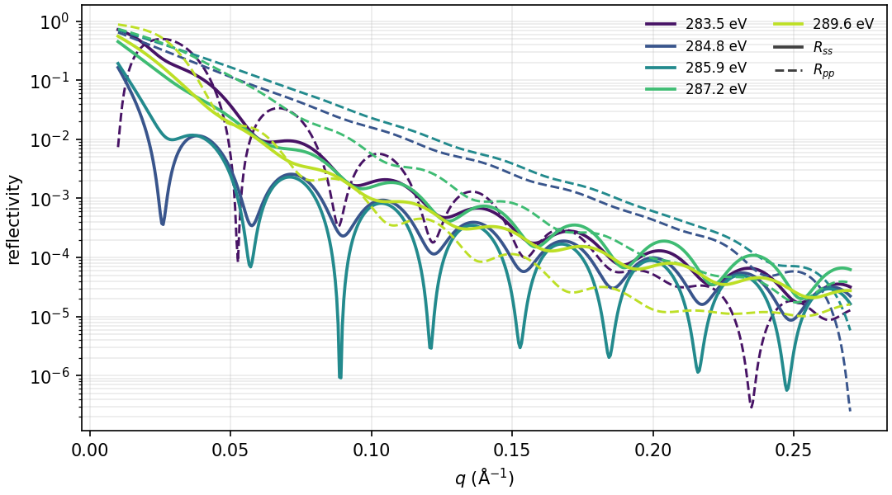
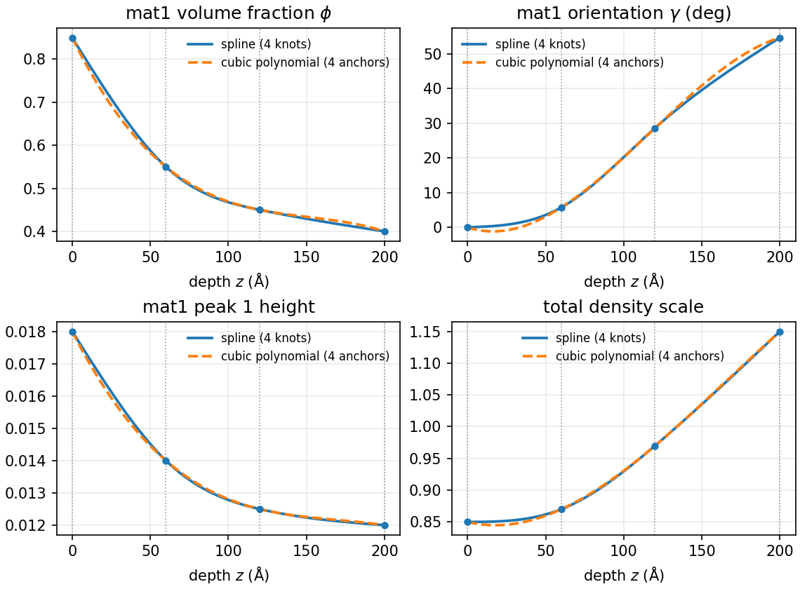

# Peak gradients

Depth-varying channels on a peak-sum optical source. A film is built from
peak-sum materials (`PeakSumSLD`) and mixed in a `DepthProfile`. Every
gradient is a `LevelField` on one shared shape, so every effect follows the
same depth profile.

## Three-material film

**Example:** `examples/lineshape_three_material.py`

Three synthetic five-peak materials fill one 200 Å film, with linear mixing
and 40 microslabs. The values are illustrative, not fitted to ZnPc or Alq3.
The peak energies (about 284.5 to 290.4 eV) sit near the carbon K edge.

One `SplineShape` with four knots spans the film, at 0, 60, 120 and 200 Å
(fractions 0, 0.3, 0.6 and 1 of the thickness $T$). The surface is at $z=0$
and the substrate at $z=T$. Every gradient is a `LevelField` with four levels
on that one shared shape. The surface and substrate levels are fixed by the
film. The two interior levels are chosen so each profile curves, rather than
following the straight line between the endpoints. The gradients are the
volume fractions, the total density, the per-material $\gamma$, the mat1 peak
1, 2 and 3 heights, and the mat1 TDM tilts of peaks 1, 2, 4 and 5. Everything
else is a constant: the mat2 and mat3 peak parameters, the mat1 peak 3 tilt,
and the mat1 peak 4 and 5 heights.

Maxwell-Garnett and Bruggeman mixing support only two components, so for
three materials the linear rule is the only choice.

The construction code below needs these imports:

```python
from collections.abc import Sequence

import numpy as np

from refloxide.fields import LevelField, PolynomialShape, Shape, SplineShape
from refloxide.lineshapes import MAGIC_ANGLE, Peak, PeakSumSLD
from refloxide.model import MaterialSLD, Mix, ReflectModel, Structure
from refloxide.profiles import DepthProfile
```

The film is `vacuum | build_profile() | substrate`:

```python
--8<-- "examples/lineshape_three_material.py:construction"
```

The example sets each channel's four levels explicitly. In words, each
channel follows this profile:

- **Volume fractions.** mat1 starts at 0.85 and falls fast over the top 60 Å
  to 0.55. It then levels off near 0.40 at the substrate. mat2 is taken up
  near the surface, rising from 0.10 to about 0.35 by 120 Å, and then stays
  flat. mat3 enriches mostly in the lower half, from 0.05 to 0.25. The three
  fractions sum to 1 at every knot.
- **Total density.** `density_scale` multiplies the mixed tensor after mixing.
  It runs from 0.85 at the surface to 1.15 at the substrate, and most of the
  rise is in the lower half.
- **Orientation.** Mat1 stays near face-on at the surface ($\gamma\approx
  6^\circ$ at 60 Å). It tilts through the lower half and reaches the magic
  angle only at the substrate. Mat2 tilts quickly near the top and saturates
  close to edge-on. Mat3 stays near the magic angle until the lower half, then
  tilts toward edge-on.
- **Electronic effects in mat1.** Peak 1 and peak 2 heights are 1.5 and 2.0
  times their substrate values at the surface, and both fall fast near the
  surface. Peak 3 rises from 0.8 times its substrate value to the substrate
  value, mostly in the top 100 Å. The heights are written out as absolute
  values, not multipliers. The TDM tilt of peaks 1 and 2 goes from $0$ at the
  surface to $20^\circ$ at the substrate, changing fastest near the surface.
  The tilt of peak 4 goes from $90^\circ$ to $80^\circ$, changing fastest near
  the surface. The tilt of peak 5 stays near $90^\circ$ until the lower half,
  then drops to $80^\circ$ at the substrate.

### Channels versus depth

Every channel, sampled on a depth grid by `DepthProfile.named_values_at`.
Angles are shown in degrees here, but the values are radians.



### Lab tensor versus depth

Ordinary and extraordinary $\delta$ and $\beta$ at five energies, 283.5 to
289.6 eV, one value per microslab. Each color is one energy. The lowest
energy, 283.5 eV, sits below the first mat1 peak. The energies 284.8, 285.9
and 287.2 eV sit on mat1 peaks 1 to 3, and 289.6 eV sits on mat1 peak 5.



### Reflectivity

$R_{ss}$ (solid) and $R_{pp}$ (dashed) over $q$ at the same five energies.
Each color is one energy.



### Swapping the profile shape

Only the shape object changes. The example builds the film with
`build_structure(shape="polynomial")` to use a cubic `PolynomialShape`
instead of the spline:

```python
from refloxide.fields import PolynomialShape

shape = PolynomialShape(degree=3, positions=[0.0, 0.3, 0.6, 1.0], name="depth")
```

The positions are fractions of the thickness, the same as the spline knots
above. The four levels of every channel stay the same, so both shapes agree
at the surface and substrate, and the rest of the film is unchanged. In the
polynomial version, each channel is a single cubic through the four anchors.

Prefer the spline when you need local control. Moving one level changes only
the nearby part of the profile, and the curve does not ring. Prefer the
polynomial when you want a smooth global trend with few parameters. A cubic
can overshoot between anchors, as the figure shows for mat1 $\gamma$ near
15 Å, where it dips slightly below zero.



The figure compares four channels with the spline (solid) and the cubic
polynomial (dashed) on the same four anchors. The dots mark the spline knot
values, and the dotted lines mark the knot and anchor positions.

## Single-material film

With one material there is no `Mix`, and the same channels still apply.
`gamma` and `density_scale` are passed to the peak-sum source and the tensor
per microslab. A peak height bound to a `LevelField` is evaluated at each
microslab.

```python
import numpy as np

from refloxide.fields import LevelField, SplineShape
from refloxide.lineshapes import MAGIC_ANGLE, Peak, PeakSumSLD
from refloxide.model import MaterialSLD, ReflectModel
from refloxide.profiles import DepthProfile

shape = SplineShape(np.linspace(0.0, 200.0, 5), name="depth")
film = PeakSumSLD(
    [
        Peak(
            label="p1",
            energy=285.9,
            width=0.5,
            height=LevelField(shape, [0.018, 0.016, 0.014, 0.012, 0.010], name="p1_height"),
        )
    ],
    name="film",
)
layer = DepthProfile(
    film,
    thickness=200.0,
    n_slabs=40,
    gamma=LevelField(shape, [0.0, 0.3, 0.6, 0.8, MAGIC_ANGLE], name="gamma"),
    density_scale=LevelField(shape, [0.9, 0.95, 1.0, 1.05, 1.1], name="density_scale"),
)
vacuum = MaterialSLD("", 0, name="vacuum")(0, 0)
substrate = MaterialSLD("Si", density=2.33, name="si")(0, 3)
structure = vacuum | layer | substrate
```

## Other field families

Any depth field can bind to a peak parameter. A `TransitionShape` gives a
relaxation from the surface and bulk to the substrate. A `LocalizedShape`
adds a Gaussian surface layer. `Derived` adds the two pointwise. Here the
orientation and density stay constant.

```python
from refloxide.fields import Derived, LocalizedShape, TransitionShape

transition = TransitionShape(tau_top=25.0, tau_bottom=40.0, name="transition")
surface = LocalizedShape(center=0.0, width=20.0, name="surface")
bulk_height = LevelField(transition, [0.014, 0.012, 0.010], name="bulk_height")
surface_bump = LevelField(surface, [0.0, 0.006], name="surface_bump")
height = Derived(
    lambda bulk, bump: bulk + bump,
    bulk=bulk_height,
    bump=surface_bump,
    name="p1_height",
)
film = PeakSumSLD(
    [Peak(label="p1", energy=285.9, width=0.5, height=height)], name="film"
)
layer = DepthProfile(
    film,
    thickness=200.0,
    n_slabs=40,
    gamma=np.deg2rad(30.0),
    density=1.0,
)
```

A plain Python function can be a channel too. `CallableField` calls
`fn(z, thickness=..., **params)` at each microslab. Here it is a ripple on the
total density of the film from the previous snippet (the one with the
`Derived` peak height).

```python
from refloxide.profiles import CallableField


def ripple(z, *, thickness, amp, period):
    """Density ripple of relative amplitude `amp` and period `period` (Angstrom)."""
    return 1.0 + amp * np.sin(2.0 * np.pi * z / period)


density_scale = CallableField(
    ripple, params={"amp": 0.05, "period": 80.0}, name="ripple"
)
layer = DepthProfile(film, thickness=200.0, n_slabs=40, density_scale=density_scale)
```

A `SinusoidShape` gives a periodic modulation. Its levels are the offset and
the amplitude, and its `wavelength` is in Å. Here the peak height ripples
about a mean of 0.012 with amplitude 0.002 and a period of 80 Å.

```python
from refloxide.fields import LevelField, SinusoidShape
from refloxide.lineshapes import Peak, PeakSumSLD
from refloxide.profiles import DepthProfile

modulation = SinusoidShape(wavelength=80.0, name="ripple")
ripple_height = LevelField(modulation, [0.012, 0.002], name="ripple_height")
film = PeakSumSLD(
    [Peak(label="p1", energy=285.9, width=0.5, height=ripple_height)], name="film"
)
layer = DepthProfile(film, thickness=200.0, n_slabs=40, gamma=0.0, density=1.0)
```

## Fitting knot positions

The knot positions of a `SplineShape` are fit parameters too. Each knot is a
`Parameter` named `depth_knot0`, `depth_knot1`, and so on for the shape named
`depth`. Knots are fixed at `vary=False` until you open them. The number of
knots is fixed when the shape is built, so every level field on the shape
keeps its level count.

The snippet builds its own five-knot shape at 0, 50, 100, 150 and 200 Å. It
is separate from the four-knot shape of the example film. It opens the two
interior knots, which start at 50 Å and 100 Å. Knot 1 is bounded to 20 to
75 Å and knot 2 to 80 to 140 Å. Those ranges do not overlap, so the knots
stay in order during a fit: knot 1 stays below knot 2, and knot 2 stays below
the fixed knot 3 at 150 Å. Knot 1 stays above the fixed knot 0 at 0 Å. Both
starts lie inside their bounds.

```python
import numpy as np

from refloxide.fields import LevelField, SplineShape
from refloxide.lineshapes import MAGIC_ANGLE, Peak, PeakSumSLD
from refloxide.profiles import DepthProfile

shape = SplineShape(np.linspace(0.0, 200.0, 5), name="depth")
shape.knot_parameters[1].setp(vary=True, bounds=(20.0, 75.0))
shape.knot_parameters[2].setp(vary=True, bounds=(80.0, 140.0))

film = PeakSumSLD(
    [
        Peak(
            label="p1",
            energy=285.9,
            width=0.5,
            height=LevelField(
                shape, [0.018, 0.016, 0.014, 0.012, 0.010], name="p1_height"
            ),
        )
    ],
    name="film",
)
layer = DepthProfile(
    film,
    thickness=200.0,
    n_slabs=40,
    gamma=LevelField(shape, [0.0, 0.3, 0.6, 0.8, MAGIC_ANGLE], name="gamma"),
    density_scale=LevelField(shape, [0.9, 0.95, 1.0, 1.05, 1.1], name="density_scale"),
)

knots = [
    p.name
    for p in layer.parameters.flattened(unique=True)
    if "depth_knot" in p.name
]
print(knots)
print([p.name for p in layer.parameters.varying_parameters() if "depth_knot" in p.name])
```

The shape is shared by `gamma`, `density_scale`, and the peak height, so in
the plain `layer.parameters.flattened()` listing the knots of a shared shape
repeat. Pass `unique=True`, as above, to list each knot once. The
`varying_parameters()` list is already unique and shows the two opened knots,
`depth_knot1` and `depth_knot2`. Running the snippet prints:

```text
['depth_knot0', 'depth_knot1', 'depth_knot2', 'depth_knot3', 'depth_knot4']
['depth_knot1', 'depth_knot2']
```

To tie one knot to another instead of bounding it, use a refnx constraint.
This keeps knot 2 exactly 40 Å above knot 1, and knot 2 is then not a free
parameter:

```python
knots = shape.knot_parameters
knots[2].setp(vary=False, constraint=knots[1] + 40.0)
```

## Conventions

- **Radians in code.** Every angle in the API is in radians. The example
  converts from degrees with `np.deg2rad`.
- **Orientation `gamma`.** The tilt of the molecular normal from the surface
  normal. $\gamma=0$ is face-on, $\gamma=\pi/2$ is edge-on, and the magic
  angle $\arccos(1/\sqrt{3})\approx54.7^\circ$ is amorphous (`MAGIC_ANGLE`).
- **TDM tilt.** The polar angle $\theta$ of a peak's transition dipole, measured
  from the molecular normal. $\theta=0$ lies along the normal and
  $\theta=\pi/2$ lies in the molecular plane. The default is `MAGIC_ANGLE`,
  which gives equal in-plane and out-of-plane strength.
- **Heights.** A peak's `height` is the height itself. There is no multiplier
  mechanism, so the example writes surface values as absolute heights.
- **Scalars are constant.** A peak parameter that is a plain number is
  evaluated once per energy. Only parameters bound to a depth field are
  evaluated per microslab.
