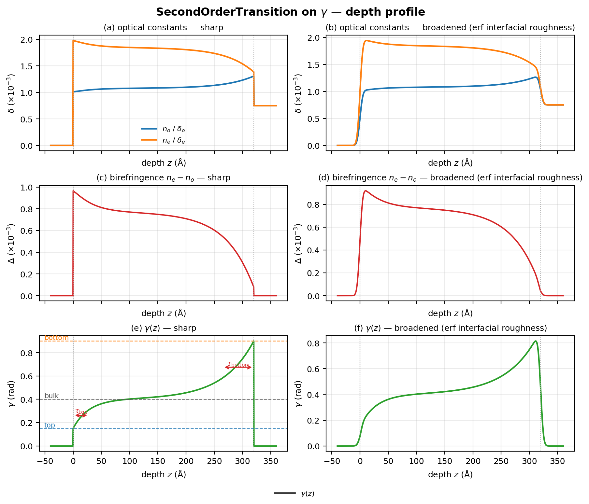
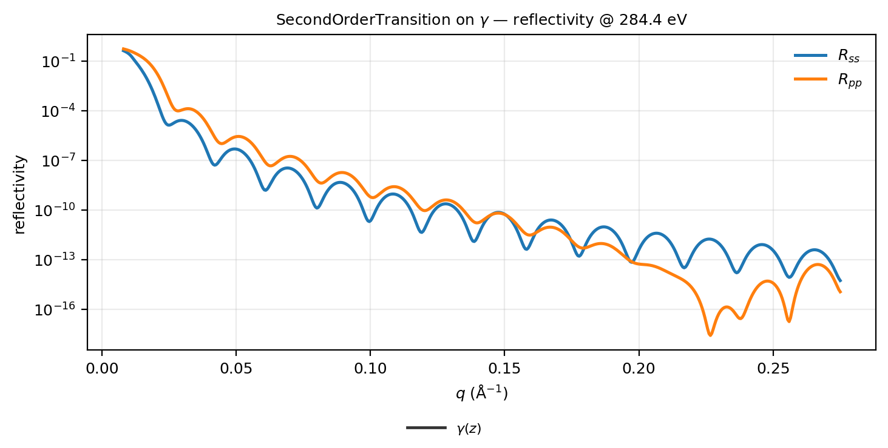
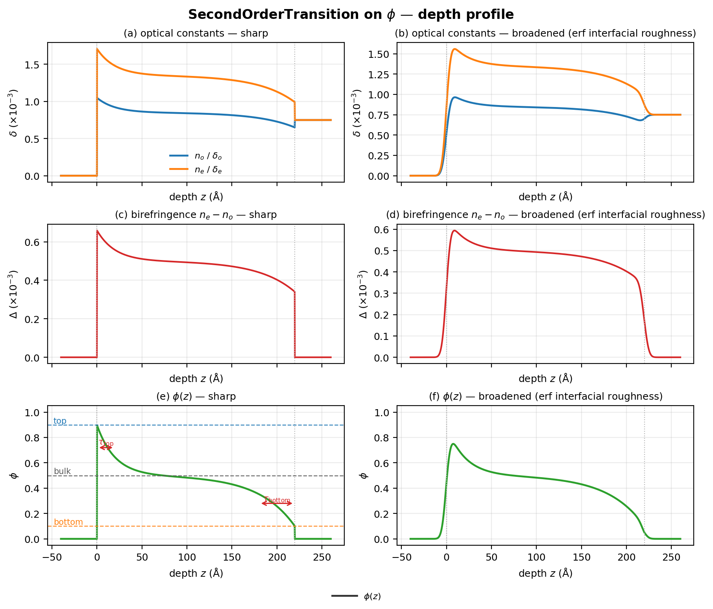
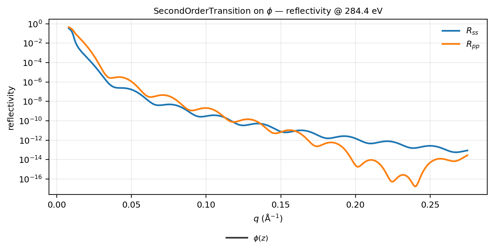
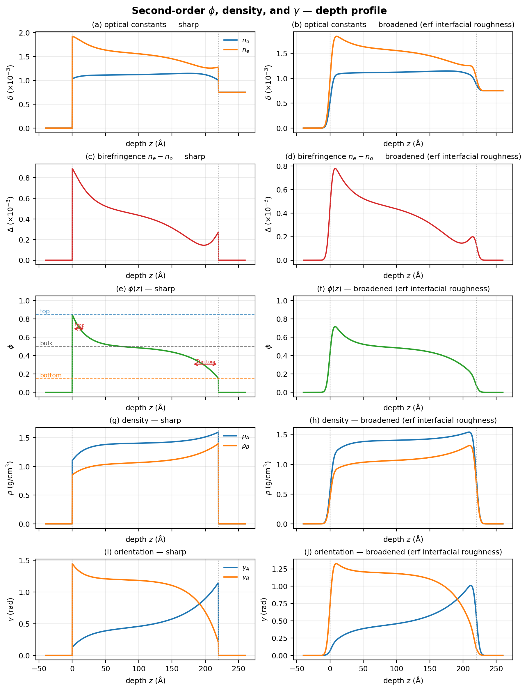
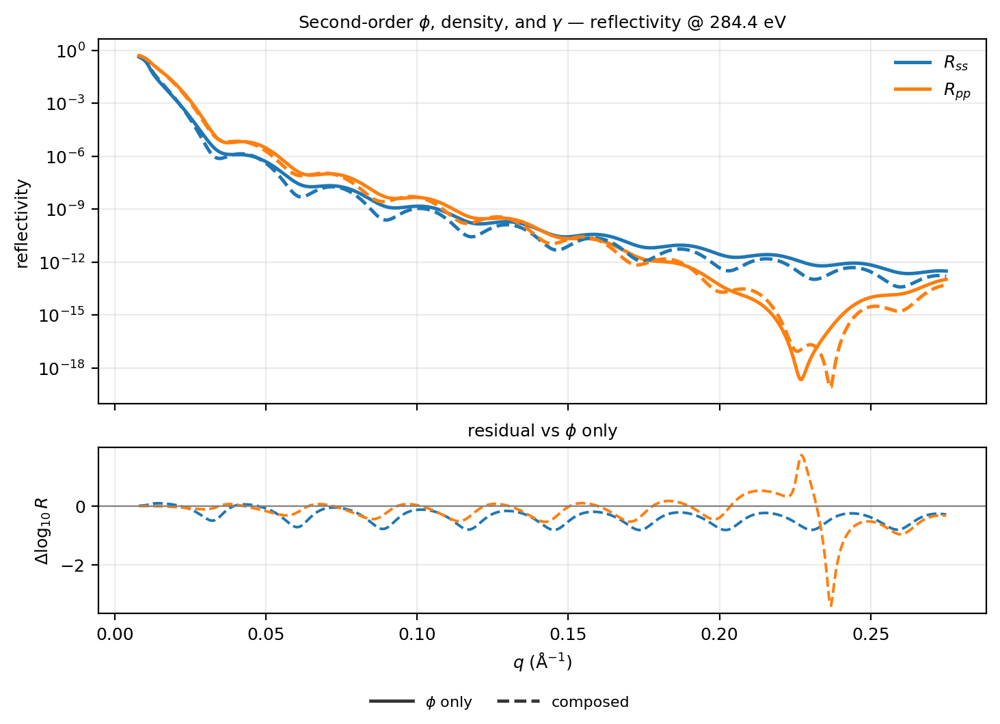
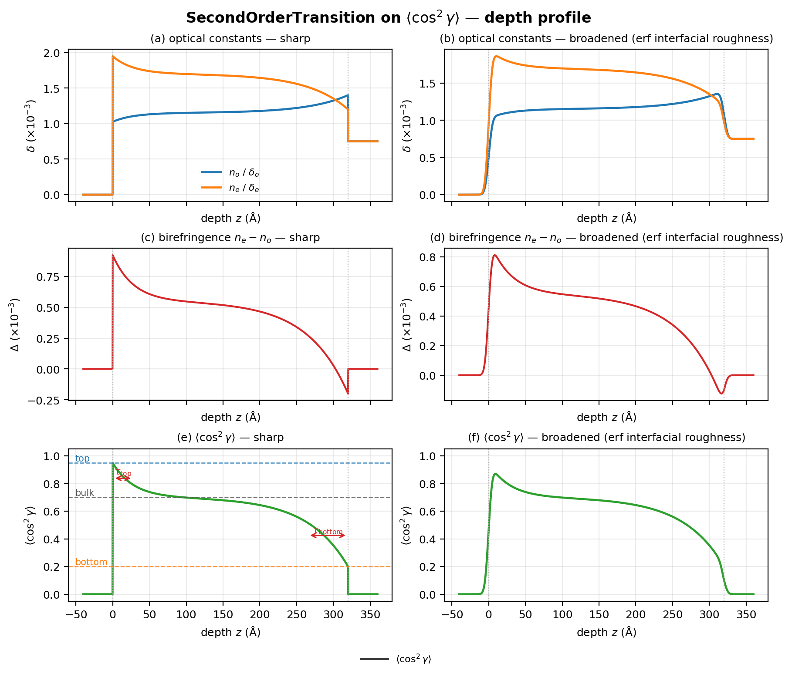
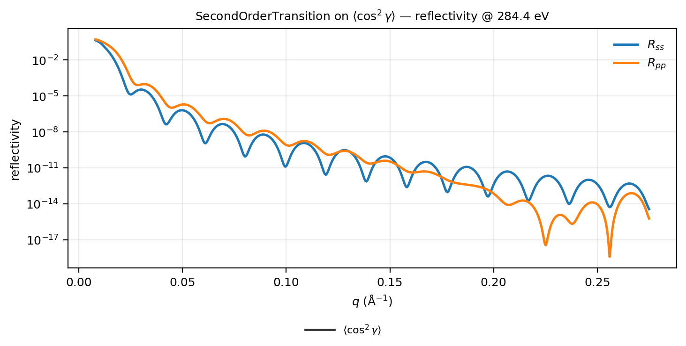
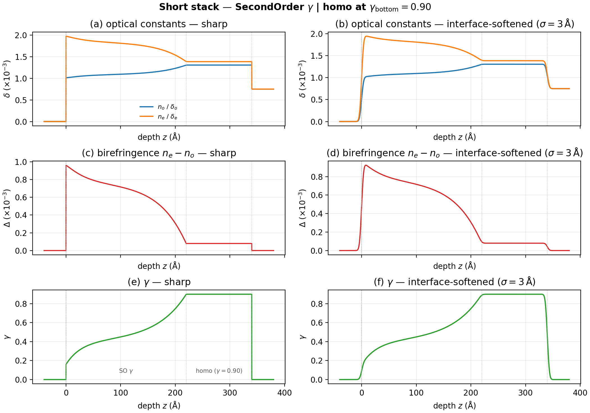
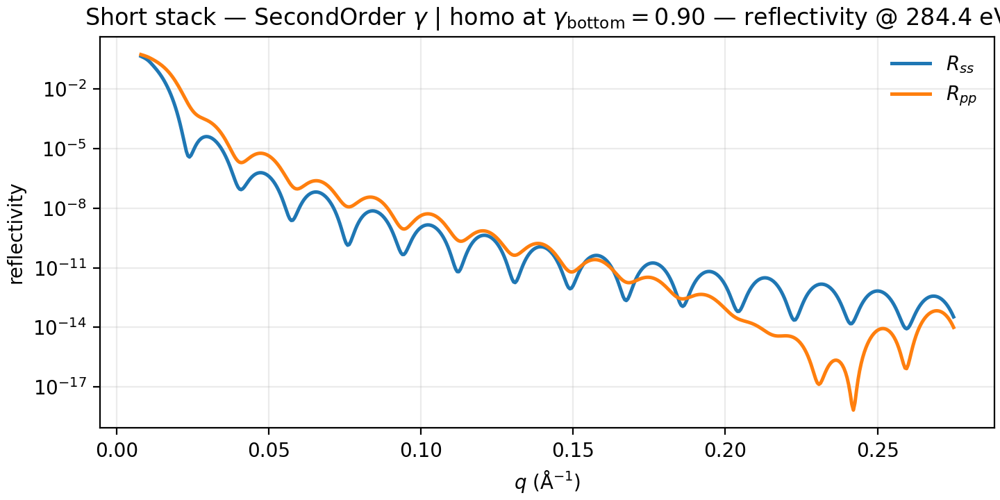

# Phase transitions

`SecondOrderTransition` profiles with annotated `top` / `bulk` / `bottom` and
decay lengths $\tau_\mathrm{top}$, $\tau_\mathrm{bottom}$. Drive orientation
($\gamma$), Mix composition ($\phi$), $\langle\cos^2\gamma\rangle$, free
optical diagonals (`delta_o` / `delta_e` / …), or, on one `Mix`, $\phi$
together with each component's density and tilt.

Shared preamble:

--8<-- "guides/building_structures/_preamble.md"

## Orientation (`gamma`)

**Builder:** `case_second_order_gamma`

```python
eta = SecondOrderTransition(
    thickness=320.0,
    bulk=0.40,
    top=0.15,
    bottom=0.90,
    tau_top=28.0,
    tau_bottom=55.0,
)
layer = DepthProfile(material=mat, thickness=320.0, roughness=2.0, gamma=eta)
stack = vac | layer | si
```





## Composition (`phi`)

**Builder:** `case_second_order_phi`

Same annotated constants, driving Mix volume fraction. Depth/reflectivity
use the profile-variant template ($n_o$/$n_e$, birefringence, $\phi$;
sharp | broadened).

```python
eta = SecondOrderTransition(
    thickness=220.0,
    bulk=0.5,
    top=0.9,
    bottom=0.1,
    tau_top=20.0,
    tau_bottom=40.0,
)
layer = DepthProfile(
    material=Mix([mat_a, mat_b], rule="linear"),
    thickness=220.0,
    phi=eta,
)
stack = vac | layer | si
```





## Composed pins (`phi`, density, orientation)

**Builder:** `case_second_order_composed`

Same `Mix` of uniaxial tensors as a homogeneous blend. `phi` on the
`DepthProfile` is the volume fraction of component A. Each component's
density and tilt are `SecondOrderTransition` fields passed to
`UniTensorSLD`, and the profile evaluates those fields at every microslab
before mixing. `Mix.vf` is frozen, because `phi(z)` is the composition
that is evaluated.

The reflectivity panel compares this film with the same $\phi(z)$ and with
density and tilt fixed at the **bulk** pins. Depth panels are the composed
film only ($n_o$/$n_e$, birefringence, $\phi$, $\rho$, $\gamma$; sharp |
broadened). `ooc_a` and `ooc_b` are `OpticalConstants` tables.

```python
a = UniTensorSLD(
    ooc_a,
    density=SecondOrderTransition(
        thickness=220.0,
        bulk=1.40,
        top=1.10,
        bottom=1.60,
        tau_top=18.0,
        tau_bottom=36.0,
        name="rho_a",
    ),
    rotation=SecondOrderTransition(
        thickness=220.0,
        bulk=0.40,
        top=0.12,
        bottom=1.15,
        tau_top=24.0,
        tau_bottom=48.0,
        name="gamma_a",
    ),
    name="a",
)
b = UniTensorSLD(
    ooc_b,
    density=SecondOrderTransition(
        thickness=220.0,
        bulk=1.05,
        top=0.85,
        bottom=1.40,
        tau_top=22.0,
        tau_bottom=42.0,
        name="rho_b",
    ),
    rotation=SecondOrderTransition(
        thickness=220.0,
        bulk=1.20,
        top=1.45,
        bottom=0.20,
        tau_top=16.0,
        tau_bottom=30.0,
        name="gamma_b",
    ),
    name="b",
)
layer = DepthProfile(
    material=Mix([a, b], rule="linear"),
    thickness=220.0,
    roughness=2.0,
    phi=SecondOrderTransition(
        thickness=220.0,
        bulk=0.50,
        top=0.85,
        bottom=0.15,
        tau_top=20.0,
        tau_bottom=40.0,
        name="phi",
    ),
    name="composed",
)
stack = vac | layer | si
```





## Order parameter (`<cos^2 gamma>`)

**Builder:** `case_second_order_cos2`

```python
eta = SecondOrderTransition(
    thickness=320.0,
    bulk=0.70,
    top=0.95,
    bottom=0.20,
    tau_top=28.0,
    tau_bottom=55.0,
)
layer = DepthProfile(material=mat, thickness=320.0, cos2_gamma=eta)
stack = vac | layer | si
```





## Stacking

**Builder:** `case_second_order_short_stack`

Orientation `SecondOrderTransition` over a homogeneous film whose constant
$\gamma$ equals the **bottom pin** ($\gamma_\mathrm{bottom}$), so the
transition settles into that orientation rather than an unrelated slab.

```python
eta = SecondOrderTransition(
    thickness=220.0,
    bulk=0.40,
    top=0.15,
    bottom=0.90,
    tau_top=28.0,
    tau_bottom=55.0,
)
orientation = DepthProfile(material=mat, thickness=220.0, roughness=2.0, gamma=eta)
# Homogeneous film at the same gamma as the bottom pin (lab diagonals via
# the same orientation map as DepthProfile with constant gamma=0.90).
pinned = DepthProfile(material=mat, thickness=120.0, gamma=0.90)
stack = vac | orientation | pinned | si
model = ReflectModel(stack, energies=[284.4], parallel=False)
```




