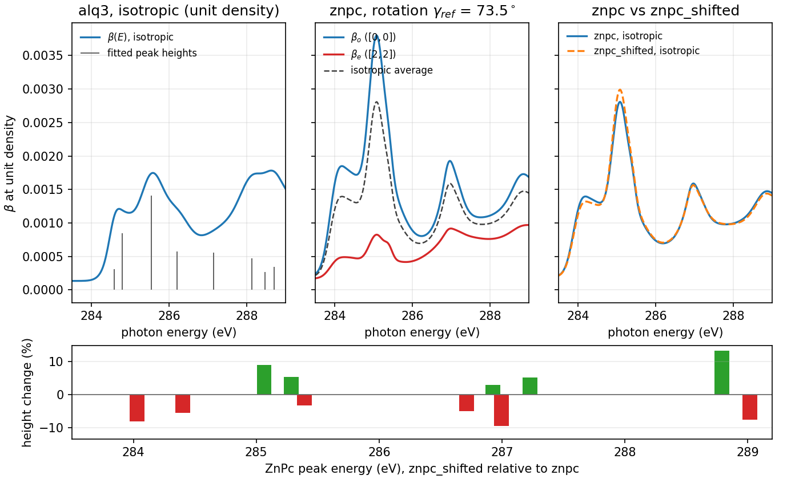
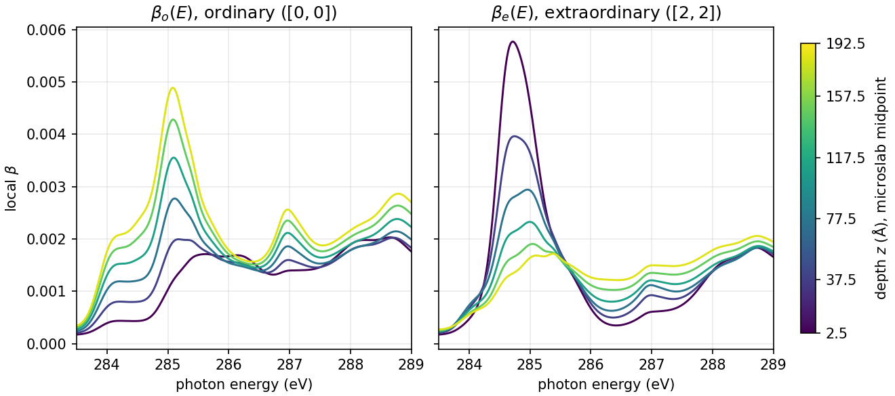
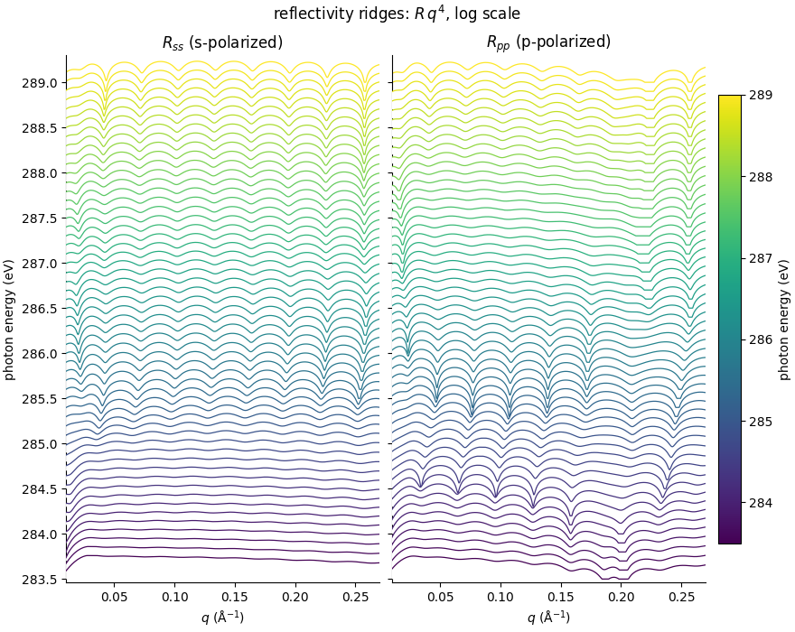
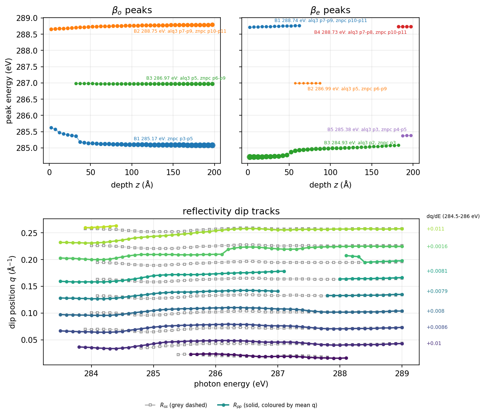

# Peak gradients

Depth-varying channels on a peak-sum optical source. A film is built from
peak-sum materials (`PeakSumSLD`) and mixed in a `DepthProfile`. Every
gradient is a `LevelField` on one shared shape, so every effect follows the
same depth profile.

For the pieces and their conventions in brief, see the
[Lineshapes integration overview](index.md).

## Three-material film

**Example:** `examples/lineshape_three_material.py`

The example film has three materials, all built from the frozen
lineshapes ZnPc and Alq3 dataset fits. The fits were
run once and frozen into `examples/data/lineshapes_materials.json`. The
example reads that file relative to its own path. The
`examples/data/freeze_lineshapes_fits.py` script regenerates it from a
lineshapes checkout (set `LINESHAPES_REPO` if the checkout is not at the
default path). The JSON records the lineshapes commit and the fit rms, and
regenerating it on the same day gives byte-identical output.

- **`alq3`** is an isotropic material: 14 Gaussian peaks, with heights in
  unit-density beta and the fit scale already folded in, plus a continuum.
  The first five peaks by energy carry the depth gradients. The other nine
  are constants.
- **`znpc`** is the full uniaxial ZnPc tensor. Its 19 peaks are fit from five
  incidence angles as film-frame strengths $F_{xx}$ and $F_{zz}$. Each peak's
  height is the isotropic strength $F_{\rm iso}=(2F_{xx}+F_{zz})/3$, and its
  TDM tilt is solved from the measured anisotropy (below).
- **`znpc_shifted`** is the same ZnPc peak set, with each height multiplied by
  a fixed factor between 0.85 and 1.15.

The density values are illustrative, not measured: Alq3 is 1.31 g/cm$^3$ and
ZnPc is 1.60 g/cm$^3$. Each `PeakSumSLD` takes its density as an argument,
since the frozen tables are per unit density.

The film is 200 Å thick with 40 microslabs and linear mixing. One
`SplineShape` with four knots spans it, at 0, 60, 120 and 200 Å (fractions
0, 0.3, 0.6 and 1 of the thickness $T$). The surface is at $z=0$, and $z=T$
is the film/oxide interface. Every gradient is a `LevelField` with four levels
on that shape. The surface and $z=T$ levels are fixed by the film. The two
interior levels are chosen so each profile curves, rather than following
the straight line between the endpoints. Maxwell-Garnett and Bruggeman mixing
support only two components, so for three materials the linear rule is the
only choice.

### Alq3: an isotropic model with depth-dependent dipoles

The Alq3 model has no tensor, so the outline is applied to its first five
peaks through heights and TDM tilts. The surface-rich outline is:

- Peaks p1, p2 and p3 have surface heights 1.5, 2.0 and 0.8 times their
  fitted (substrate) values. The surface level is the ratio times the fitted
  height. The interior levels follow the curved four-level pattern
  $h\,(1+(r-1)w)$ with weights $w=(1, 1/3, 1/12, 0)$, so the height relaxes
  to the fitted value at $z=T$.
- The TDM tilt of p1 and p2 goes from $0$ (along the molecular normal) at the
  surface to $20^\circ$ at $z=T$, through $12^\circ$ and $17^\circ$ at 60 and
  120 Å for p1 (and $14^\circ$ and $18^\circ$ for p2).
- The TDM tilt of p4 and p5 goes from $90^\circ$ (in the molecular plane) at
  the surface to $80^\circ$ at $z=T$.
- Every other Alq3 peak is a constant at its fitted height, with
  `tdm_tilt=MAGIC_ANGLE`, which is isotropic.

| Peak | Energy (eV) | Fitted height (z = T) | Surface height | TDM tilt, surface | TDM tilt, z = T |
|---|---|---|---|---|---|
| p1 | 284.59 | $3.068\times10^{-4}$ | $4.603\times10^{-4}$ (1.5x) | 0° | 20° |
| p2 | 284.80 | $8.434\times10^{-4}$ | $1.687\times10^{-3}$ (2.0x) | 0° | 20° |
| p3 | 285.54 | $1.407\times10^{-3}$ | $1.126\times10^{-3}$ (0.8x) | magic angle | magic angle |
| p4 | 286.20 | $5.733\times10^{-4}$ (constant) | same | 90° | 80° |
| p5 | 287.14 | $5.550\times10^{-4}$ (constant) | same | 90° | 80° |

The fitted heights are unit-density beta. Heights are absolute values, not
multipliers.

### ZnPc: the full uniaxial tensor

The ZnPc peaks come from the five-angle series. The film-frame strengths obey
$I(\theta)=F_{xx}\sin^2\theta+F_{zz}\cos^2\theta$ for incidence angle
$\theta$. A peak's TDM polar angle $\vartheta$ (measured from the molecular
normal) gives the molecular fractions `tdm_fractions`: $f_{xx}=1.5\sin^2\vartheta$
and $f_{zz}=3\cos^2\vartheta$. Those fractions average to 1, so each peak's
height is $F_{\rm iso}$.

The tilt is solved from the film anisotropy. With molecular tilt $\gamma$
(the orientation of the molecular normal), the film ratio of the
extraordinary to the ordinary index is

$$
\rho(\vartheta,\gamma)=\frac{f_{zz}\cos^2\gamma+f_{xx}\sin^2\gamma}
{\tfrac12\left[f_{xx}(1+\cos^2\gamma)+f_{zz}\sin^2\gamma\right]}.
$$

At $\vartheta=0$ this is $\rho = 2\cos^2\gamma/\sin^2\gamma$. The helper
`znpc_tilts` derives $\gamma_{\rm ref}$ from the data in three steps:

1. It takes the strong low-energy $\pi^*$ peaks: energy below 286 eV and
   $F_{\rm iso}$ above 10 % of the largest. These are five peaks, at 284.03,
   284.40, 285.06, 285.28 and 285.39 eV. They are assumed to have their TDM
   along the molecular normal.
2. It forms $r=\sum F_{zz}/\sum F_{xx}$ over those peaks, which is 0.176 here.
   Then $\gamma_{\rm ref}=\arctan\sqrt{2/r}$, which gives **73.50°**.
3. For every peak it solves $\rho(\vartheta,\gamma_{\rm ref})=F_{zz}/F_{xx}$
   for $\vartheta\in[0,\pi/2]$. The root is found with `brentq` in
   $u=\cos^2\vartheta$. The reachable ratios at $\gamma_{\rm ref}$ run from
   $0.176$ at $\vartheta=0$ to $1.70$ at $\vartheta=\pi/2$. A measured ratio
   above the maximum clips to $\vartheta=\pi/2$. A measured ratio below the
   minimum clips to $\vartheta=0$, which is the closest reachable response.
   This includes $F_{zz}=0$, which has a ratio of zero.

Seven of the 19 peaks clip. Five have a measured ratio below the minimum
(284.03, 285.28, 286.71, 286.99 and 288.79 eV) and clip to $\vartheta=0$.
Two have a ratio above the maximum (298.68 and 303.11 eV) and clip to
$\vartheta=\pi/2$. Two of the low-ratio peaks have $F_{zz}=0$ exactly
(286.71 and 288.79 eV). Their ratio is zero, so they clip to $\vartheta=0$
like the other low-ratio peaks.

Check: at $\gamma_{\rm ref}$, the pure ZnPc tensor reproduces the measured
film ratio for each of the 12 unclipped peaks. The worst relative deviation is
$7\times10^{-13}$. The isotropic average of each peak's tensor equals
`height_iso` to $2\times10^{-16}$. The example prints both numbers when it runs.

The ZnPc orientation channel goes from `MAGIC_ANGLE` at the surface to
$\gamma_{\rm ref}$ at $z=T$. Its interior levels are 59.4° at 60 Å and 68.2°
at 120 Å. The `znpc_shifted` channel uses the same endpoints with a
slightly different interior: 57.0° at 60 Å and 65.1° at 120 Å, so the two
ZnPc layers are distinguishable in the channel figure.

### Shifted ZnPc

`znpc_shifted` has the same peak energies, widths, tilts and baseline as
`znpc`. Each height is multiplied by a fixed factor from
`np.random.default_rng(12345).uniform(0.85, 1.15, 19)`. The factors are
illustrative, and they are written out as absolute heights:

| Peak | Energy (eV) | Factor | Peak | Energy (eV) | Factor |
|---|---|---|---|---|---|
| p1 | 284.03 | 0.9182 | p11 | 289.02 | 0.9245 |
| p2 | 284.40 | 0.9450 | p12 | 290.43 | 1.1347 |
| p3 | 285.06 | 1.0892 | p13 | 291.60 | 1.0502 |
| p4 | 285.28 | 1.0529 | p14 | 292.70 | 0.8788 |
| p5 | 285.39 | 0.9673 | p15 | 294.10 | 0.9826 |
| p6 | 286.71 | 0.9498 | p16 | 298.68 | 1.1159 |
| p7 | 286.93 | 1.0295 | p17 | 303.11 | 1.0592 |
| p8 | 286.99 | 0.9060 | p18 | 305.62 | 0.9479 |
| p9 | 287.23 | 1.0518 | p19 | 315.00 | 1.0702 |
| p10 | 288.79 | 1.1325 | | | |

### Construction code

The construction code below needs these imports:

```python
from __future__ import annotations

import json
from collections.abc import Sequence
from pathlib import Path
from typing import Any, Literal

import numpy as np
import polars as pl
from numpy.typing import NDArray
from scipy.optimize import brentq

from refloxide.data import OpticalConstants
from refloxide.fields import LevelField, PolynomialShape, Shape, SplineShape
from refloxide.lineshapes import MAGIC_ANGLE, Peak, PeakSumSLD, tdm_fractions
from refloxide.model import MaterialSLD, Mix, ReflectModel, Structure
from refloxide.profiles import DepthProfile
```

The included block reads the frozen data file from the example's own path
(`DATA_FILE`, from `__file__`). Run it as the example module, not pasted
into a bare session.

```python
--8<-- "examples/lineshape_three_material.py:construction"
```

The stack is vacuum | film | native SiO2 | Si, built as
`vacuum | build_profile() | oxide | substrate`. The oxide is a 15 Å SiO2 slab
on the silicon substrate. The oxide thickness and both roughness values are
illustrative.

Roughness follows the library convention: a slab's `rough` is the roughness
of the interface directly above it. So the film's own `roughness` (left at 0,
sharp) is the vacuum/film interface, the oxide's `rough` (3 Å) is the
film/oxide interface, and the substrate's `rough` (3 Å) is the oxide/Si
interface.

The ZnPc result is printed with one call:

```python
gamma_ref, thetas, clipped = znpc_tilts()
print(f"gamma_ref = {np.rad2deg(gamma_ref):.2f} deg")
print("clipped:", ", ".join(clipped))
```

Each channel follows this profile:

- **Volume fractions.** Alq3 starts at 0.85 and falls fast over the top 60 Å
  to 0.55, then levels off near 0.40 at $z=T$. The two ZnPc layers enrich
  toward the substrate. ZnPc rises from 0.10 to about 0.36 near 90 Å, then
  settles at 0.35. Shifted ZnPc rises from 0.05 to 0.25. The three fractions
  sum to 1 at every knot.
- **Total density.** `density_scale` multiplies the mixed tensor after mixing.
  It runs from 0.85 at the surface to 1.15 at $z=T$. Most of the rise is in
  the lower half.
- **Orientation.** Alq3 stays near face-on at the surface and reaches the
  magic angle at $z=T$. Both ZnPc layers start at the magic angle and order
  toward $\gamma_{\rm ref}$, 73.5°, with shifted ZnPc ordering a little later
  in depth.
- **Alq3 peaks.** The heights of p1 to p3 and the TDM tilts of p1, p2, p4 and
  p5 follow the outline table above.

### Channels versus depth

Every channel, sampled on a depth grid by `DepthProfile.named_values_at`.
Angles are shown in degrees here, but the values are radians.


### Building blocks over 283.5 to 289 eV

The unit-density beta of each material on the 0.02 eV grid, from
`tensor_at_many` at density 1. The Alq3 curve uses its fitted (substrate-end)
heights, and its sticks mark those heights at the peak energies. The ZnPc
panel shows the diagonal of the lab tensor at $\gamma_{\rm ref}$. The
$[0,0]$ element is the ordinary $\beta_o$, the $[2,2]$ element is the
extraordinary $\beta_e$, and the dashed line is their average. The right
panel overlays the isotropic average of `znpc` and `znpc_shifted`. The strip
below shows the height change of each shifted ZnPc peak in percent, placed
at the nominal peak energy. The three panels share one y axis, since all
curves are at unit density.



### Depth-resolved NEXAFS

The local response of the film, from the slab tensors of
`DepthProfile.tensor_rows_at` (the density scale is included). They are
taken at the microslab midpoint nearest each depth. The depths used are
2.5, 37.5, 77.5, 117.5, 157.5 and 192.5 Å, which are the midpoints nearest to
the requested 5, 40, 80, 120, 160 and 195 Å on the 5 Å slab grid. The
energy grid is 283.5 to 289.0 eV at 0.02 eV, 276 points. Each line is one
depth, colored by depth. The left panel is $\beta_o$ and the right panel is
$\beta_e$.



Near the surface, $\beta_e$ has its strongest feature, near 284.7 eV. It
falls with depth. $\beta_o$ grows with depth and its maximum sits near
285.1 eV. The features near 287 and 288.8 eV appear in $\beta_o$ and grow with depth.

### Reflectivity ridge plot

The reflectivity of the whole film at 56 energies from 283.5 to 289.0 eV, in
0.1 eV steps, with one ridge per energy stacked as in a joyplot. Each ridge
shows the Fresnel-flattened quantity $\log_{10}(R\,q^4)$, on a log scale.
Multiplying by $q^4$ removes the steep decay of $R$ with $q$, so the dips and
fringes sit on one scale. Each panel has one window, shared by all of its
rows: the top is the 99.9th percentile of the panel's values and the window
is 2.8 decades wide. Values below the window are drawn at its bottom. Each
ridge rises by up to 2.6 row spacings, so neighbouring ridges overlap. The
ridge at the bottom of the page (283.5 eV) is drawn in front, and it hides the
parts of the ridges above it. The left panel is $R_{ss}$ and the right panel
is $R_{pp}$. Both use the same rows and the same q axis, 520 points from 0.01
to 0.27 Å$^{-1}$. Color is the photon energy.



The $R_{pp}$ panel has the sharpest minima. Between about 284 and 285 eV they
sit at low q, near 0.03 to 0.05 Å$^{-1}$. As the energy rises through 285.5 eV
they move to higher q, to about 0.1 to 0.2 Å$^{-1}$. The $R_{ss}$ panel shows
a set of minima that stays at nearly fixed q across the energy range. The
migration analysis below quantifies both.

### Peak migration

The migration figure has two parts. The top part follows the absorption
peaks of the film in depth. The bottom part follows the reflectivity dips in
energy. Both use the same film model.



**Top: NEXAFS peak branches versus depth.** The local $\beta_o(E)$ and
$\beta_e(E)$ of the film, at each of the 40 microslabs, on a 0.01 eV grid
from 283.5 to 289.0 eV (551 points). At each slab, local maxima are found with
`scipy.signal.find_peaks`. A maximum counts only if its prominence is at
least 2 % of the channel's full range over all depths. The peaks are linked
across depth into branches. At each slab, each peak joins the open branch
whose last peak is closest in energy, within 0.25 eV. A branch with no peak
within that tolerance at the next slab ends. Branches with at least three
slabs are kept. Branches can start or end with depth, and the figure shows
them as they are. Marker size is proportional to the local beta height, within
each panel. Each branch is labeled with its mean energy and the frozen alq3
and ZnPc peaks within 0.3 eV of that mean. The labels give the peak index in
the energy order of each frozen list.

Branches found by the procedure above:

| Channel | Branch | Depth (Å) | Mean energy (eV) | Shift over depth (eV) | Nearby peaks |
|---|---|---|---|---|---|
| $\beta_o$ | B1 | 2.5 to 197.5 | 285.17 | -0.54 (285.62 to 285.08) | ZnPc p3 to p5 |
| $\beta_o$ | B2 | 2.5 to 197.5 | 288.75 | +0.14 (288.65 to 288.79) | alq3 p7 to p9, ZnPc p10 to p11 |
| $\beta_o$ | B3 | 32.5 to 197.5 | 286.97 | -0.01 (286.98 to 286.97) | alq3 p5, ZnPc p6 to p9 |
| $\beta_e$ | B1 | 2.5 to 62.5 | 288.74 | +0.05 (288.71 to 288.76) | alq3 p7 to p9, ZnPc p10 to p11 |
| $\beta_e$ | B2 | 57.5 to 87.5 | 286.99 | 0.00 | alq3 p5, ZnPc p6 to p9 |
| $\beta_e$ | B3 | 2.5 to 182.5 | 284.93 | +0.36 (284.72 to 285.08) | alq3 p2, ZnPc p3 |
| $\beta_e$ | B4 | 182.5 to 197.5 | 288.73 | 0.00 | alq3 p7 to p8, ZnPc p10 to p11 |
| $\beta_e$ | B5 | 187.5 to 197.5 | 285.38 | +0.01 (285.37 to 285.38) | alq3 p3, ZnPc p4 to p5 |

The shift is the energy at the deepest slab minus the energy at the
shallowest slab of the branch. The nearby peaks are the frozen peaks within
0.3 eV of the branch mean. Two branches, $\beta_o$ B1 and $\beta_e$ B3, carry
most of the depth dependence. $\beta_o$ B1 is at 285.6 eV at the surface,
drops quickly over the top 40 Å, and then holds near 285.1 eV. $\beta_e$ B3
rises from 284.7 eV to 285.1 eV. It has a step near 50 Å and then a steady
rise to 180 Å. The other
branches are short or nearly fixed in energy.

**Bottom: reflectivity dip tracks.** At each energy of the ridge grid, local
minima of $\log_{10}(R\,q^4)$ versus $q$ are found with `find_peaks`, using a
prominence of at least 0.1 decades. The dips are linked across energy by
nearest q. A dip joins the open track whose last dip is within
0.012 Å$^{-1}$, and a track with no dip within that tolerance ends. Tracks with
at least four energies are kept. The solid lines are $R_{pp}$ and the dashed
lines are $R_{ss}$. The $R_{ss}$ tracks are drawn as thin light-grey dashed
lines with open markers, as background. Each $R_{pp}$ track is solid, with
filled markers, and it has one colour from the viridis colormap, chosen by its
mean q, so each track has its own colour. The slope $dq/dE$, in Å$^{-1}$ per
eV, is a least-squares fit over the track's points between 284.5 and 286 eV.
Each $R_{pp}$ track that spans 284.5 to 286 eV has its slope printed in the
right margin, in its colour, at the height of its right end. Tracks that do
not span that window have no slope and no label.

Tracks that span at least 3 eV are listed below: seven $R_{pp}$ tracks and
eight $R_{ss}$ tracks. Shorter tracks are not listed. Seven of the listed
$R_{ss}$ tracks span from about 284 eV to 289 eV, so the s-polarized
dips also form stable tracks.

| Pol. | Energy (eV) | q range (Å$^{-1}$) | Slope dq/dE, 284.5 to 286 eV (Å$^{-1}$/eV) |
|---|---|---|---|
| $R_{pp}$ | 283.5 to 287.0 | 0.127 to 0.142 | +0.0079 |
| $R_{pp}$ | 283.5 to 287.1 | 0.158 to 0.178 | +0.0081 |
| $R_{pp}$ | 283.5 to 289.0 | 0.064 to 0.079 | +0.0086 |
| $R_{pp}$ | 283.5 to 289.0 | 0.096 to 0.110 | +0.0080 |
| $R_{pp}$ | 283.5 to 289.0 | 0.200 to 0.225 | +0.0016 |
| $R_{pp}$ | 283.5 to 289.0 | 0.231 to 0.258 | +0.0106 |
| $R_{pp}$ | 283.8 to 289.0 | 0.034 to 0.049 | +0.0101 |
| $R_{ss}$ | 283.9 to 289.0 | 0.065 to 0.073 | +0.0048 |
| $R_{ss}$ | 283.9 to 289.0 | 0.252 to 0.259 | +0.0013 |
| $R_{ss}$ | 284.0 to 289.0 | 0.096 to 0.104 | +0.0039 |
| $R_{ss}$ | 284.0 to 289.0 | 0.220 to 0.227 | +0.0014 |
| $R_{ss}$ | 284.1 to 289.0 | 0.127 to 0.134 | +0.0033 |
| $R_{ss}$ | 284.1 to 289.0 | 0.158 to 0.165 | +0.0025 |
| $R_{ss}$ | 284.1 to 289.0 | 0.189 to 0.196 | +0.0020 |
| $R_{ss}$ | 284.8 to 289.0 | 0.035 to 0.044 | not defined (does not span 284.5 to 286 eV) |

Slopes of the $R_{ss}$ tracks are shown in the table only; they are not labeled
in the figure.

The listed $R_{pp}$ tracks move to higher q with energy. Their slopes are
about +0.008 to +0.011 Å$^{-1}$/eV, except the track near 0.20 to 0.23
Å$^{-1}$, which is about +0.002. The listed $R_{ss}$ tracks also move to
higher q, but more slowly: their slopes are +0.001 to +0.005 Å$^{-1}$/eV.

**What moves, and why.** The depth dependence of the absorption branches is
mostly in the $\beta_o$ B1 and $\beta_e$ B3 branches, by up to 0.54 eV. This
follows from the depth profile. The alq3 fraction falls from 0.85 to 0.40
while the two ZnPc layers rise, and the orientation of each material changes
with depth. So the local response near 285 eV is a mix of nearby material
peaks, and the weight of each one changes with depth. I did not separate
these effects in the model. The reflectivity dips move with energy because
the film's energy-dependent index sets the q at which each interference
minimum falls. The $R_{pp}$ dips move more than the $R_{ss}$ dips, which
matches the stronger energy dependence of $R_{pp}$ in the ridge plot.

### Spline and polynomial shapes

The shape object is the only thing that changes between the two versions.
`build_structure(shape="polynomial")` uses a cubic `PolynomialShape` through
the same four anchor positions and the same level values:

```python
from refloxide.fields import PolynomialShape

shape = PolynomialShape(degree=3, positions=[0.0, 0.3, 0.6, 1.0], name="depth")
```

The positions are fractions of the thickness, the same as the spline knots
above. The four levels of every channel stay the same, so both shapes agree
at the anchors, and the rest of the film is unchanged.

The two shapes spread a level's effect differently. The spline is a natural
cubic spline. Changing one level moves the profile mainly near its knot, and
the effect falls off with distance, but it is not zero far away. The cubic
polynomial is one global cubic through the four anchors, so every level moves
the whole curve. In the figure, the polynomial alq3 $\gamma$ dips slightly below
zero, to about $-1^\circ$, between 0 and 40 Å, while the spline stays
non-negative. The polynomial total density also dips to about 0.845 near 20 Å.

Choose the spline when you want each level's influence kept near its knot.
Choose the polynomial when you want one smooth curve through the anchors, and
accept that every level moves the whole profile.


The figure compares four channels with the spline (solid) and the cubic
polynomial (dashed) on the same four anchors: the alq3 volume fraction, the
alq3 $\gamma$, the alq3 peak p1 height and the total density scale. The dots
mark the spline knot values, and the dotted lines mark the knot and anchor
positions.

## Single-material film

With one material there is no `Mix`, and the same channels still apply.
This snippet builds the Alq3 material on the same four-knot shape. Its
volume fraction is 1, so `density_scale` and `gamma` act on that one material
alone:

```python
shape = make_shape()
materials = load_materials()
alq3 = PeakSumSLD(
    alq3_peaks(shape, materials["alq3"]),
    baseline=baseline_table(materials["alq3"]),
    density=DENSITY_ALQ3,
    name="alq3",
)
layer = DepthProfile(
    alq3,
    thickness=THICKNESS,
    n_slabs=N_SLABS,
    gamma=LevelField(shape, [0.0, 0.10, 0.50, MAGIC_ANGLE], name="gamma"),
    density_scale=LevelField(shape, [0.85, 0.87, 0.97, 1.15], name="density_scale"),
)
vacuum = MaterialSLD("", 0, name="vacuum")(0, 0)
oxide = MaterialSLD("SiO2", density=2.2, name="native_oxide")(15.0, 3.0)
substrate = MaterialSLD("Si", density=2.33, name="substrate")(0, 3.0)
structure = vacuum | layer | oxide | substrate
```

## Other field families

Any depth field can bind to a peak parameter. A `TransitionShape` gives a
relaxation from the surface and bulk to the substrate. A `LocalizedShape`
adds a Gaussian surface layer. `Derived` adds the two pointwise. Here the
orientation and density stay constant. These snippets are standalone: they
use their own peak and do not depend on the example film.

```python
import numpy as np

from refloxide.fields import Derived, LevelField, LocalizedShape, TransitionShape
from refloxide.lineshapes import Peak, PeakSumSLD
from refloxide.profiles import DepthProfile

transition = TransitionShape(tau_top=25.0, tau_bottom=40.0, name="transition")
surface = LocalizedShape(center=0.0, width=20.0, name="surface")
bulk_height = LevelField(transition, [0.014, 0.012, 0.010], name="bulk_height")
surface_bump = LevelField(surface, [0.0, 0.006], name="surface_bump")
height = Derived(
    lambda bulk, bump: bulk + bump,
    bulk=bulk_height,
    bump=surface_bump,
    name="p1_height",
)
film = PeakSumSLD(
    [Peak(label="p1", energy=285.9, width=0.5, height=height)], name="film"
)
layer = DepthProfile(
    film,
    thickness=200.0,
    n_slabs=40,
    gamma=np.deg2rad(30.0),
    density=1.0,
)
```

A plain Python function can be a channel too. `CallableField` calls
`fn(z, thickness=..., **params)` at each microslab. Here it is a ripple on the
total density of the film from the previous snippet (the one with the
`Derived` peak height).

```python
from refloxide.profiles import CallableField


def ripple(z, *, thickness, amp, period):
    """Density ripple of relative amplitude `amp` and period `period` (Angstrom)."""
    return 1.0 + amp * np.sin(2.0 * np.pi * z / period)


density_scale = CallableField(
    ripple, params={"amp": 0.05, "period": 80.0}, name="ripple"
)
layer = DepthProfile(film, thickness=200.0, n_slabs=40, density_scale=density_scale)
```

A `SinusoidShape` gives a periodic modulation. Its levels are the offset and
the amplitude, and its `wavelength` is in Å. Here the peak height ripples
about a mean of 0.012 with amplitude 0.002 and a period of 80 Å.

```python
from refloxide.fields import LevelField, SinusoidShape
from refloxide.lineshapes import Peak, PeakSumSLD
from refloxide.profiles import DepthProfile

modulation = SinusoidShape(wavelength=80.0, name="ripple")
ripple_height = LevelField(modulation, [0.012, 0.002], name="ripple_height")
film = PeakSumSLD(
    [Peak(label="p1", energy=285.9, width=0.5, height=ripple_height)], name="film"
)
layer = DepthProfile(film, thickness=200.0, n_slabs=40, gamma=0.0, density=1.0)
```

## Fitting knot positions

The knot positions of a `SplineShape` are fit parameters too. Each knot is a
`Parameter` named `depth_knot0`, `depth_knot1`, and so on for the shape named
`depth`. Knots are fixed at `vary=False` until you open them. The number of
knots is fixed when the shape is built, so every level field on the shape
keeps its level count.

The snippet builds its own five-knot shape at 0, 50, 100, 150 and 200 Å. It
is separate from the four-knot shape of the example film. It opens the two
interior knots, which start at 50 Å and 100 Å. Knot 1 is bounded to 20 to
75 Å and knot 2 to 80 to 140 Å. Those ranges do not overlap, so the knots
stay in order during a fit: knot 1 stays below knot 2, and knot 2 stays below
the fixed knot 3 at 150 Å. Knot 1 stays above the fixed knot 0 at 0 Å. Both
starts lie inside their bounds.

```python
import numpy as np

from refloxide.fields import LevelField, SplineShape
from refloxide.lineshapes import MAGIC_ANGLE, Peak, PeakSumSLD
from refloxide.profiles import DepthProfile

shape = SplineShape(np.linspace(0.0, 200.0, 5), name="depth")
shape.knot_parameters[1].setp(vary=True, bounds=(20.0, 75.0))
shape.knot_parameters[2].setp(vary=True, bounds=(80.0, 140.0))

film = PeakSumSLD(
    [
        Peak(
            label="p1",
            energy=285.9,
            width=0.5,
            height=LevelField(
                shape, [0.018, 0.016, 0.014, 0.012, 0.010], name="p1_height"
            ),
        )
    ],
    name="film",
)
layer = DepthProfile(
    film,
    thickness=200.0,
    n_slabs=40,
    gamma=LevelField(shape, [0.0, 0.3, 0.6, 0.8, MAGIC_ANGLE], name="gamma"),
    density_scale=LevelField(shape, [0.9, 0.95, 1.0, 1.05, 1.1], name="density_scale"),
)

knots = [
    p.name
    for p in layer.parameters.flattened(unique=True)
    if "depth_knot" in p.name
]
print(knots)
print([p.name for p in layer.parameters.varying_parameters() if "depth_knot" in p.name])
```

The shape is shared by `gamma`, `density_scale`, and the peak height, so in
the plain `layer.parameters.flattened()` listing the knots of a shared shape
repeat. Pass `unique=True`, as above, to list each knot once. The
`varying_parameters()` list is already unique and shows the two opened knots,
`depth_knot1` and `depth_knot2`. Running the snippet prints:

```text
['depth_knot0', 'depth_knot1', 'depth_knot2', 'depth_knot3', 'depth_knot4']
['depth_knot1', 'depth_knot2']
```

To tie one knot to another instead of bounding it, use a refnx constraint.
This keeps knot 2 exactly 40 Å above knot 1, and knot 2 is then not a free
parameter:

```python
knots = shape.knot_parameters
knots[2].setp(vary=False, constraint=knots[1] + 40.0)
```

## Conventions

- **Radians in code.** Every angle in the API is in radians. The example
  converts from degrees with `np.deg2rad`.
- **Orientation `gamma`.** The tilt of the molecular normal from the surface
  normal. $\gamma=0$ is face-on, $\gamma=\pi/2$ is edge-on, and the magic
  angle $\arccos(1/\sqrt{3})\approx54.7^\circ$ is amorphous (`MAGIC_ANGLE`).
- **TDM tilt.** The polar angle $\theta$ of a peak's transition dipole, measured
  from the molecular normal. $\theta=0$ lies along the normal and
  $\theta=\pi/2$ lies in the molecular plane. The default is `MAGIC_ANGLE`,
  which gives equal in-plane and out-of-plane strength.
- **Heights.** A peak's `height` is the height itself. There is no multiplier
  mechanism, so the example writes surface values as absolute heights.
- **Scalars are constant.** A peak parameter that is a plain number is
  evaluated once per energy. Only parameters bound to a depth field are
  evaluated per microslab.
