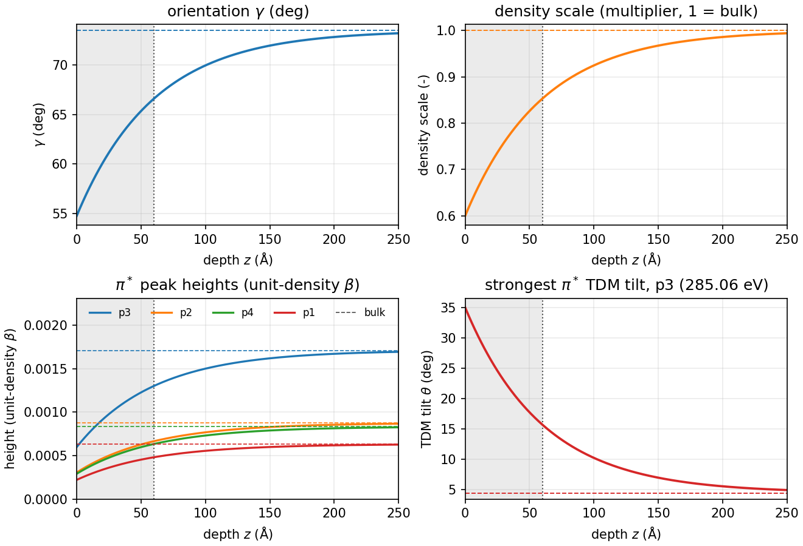
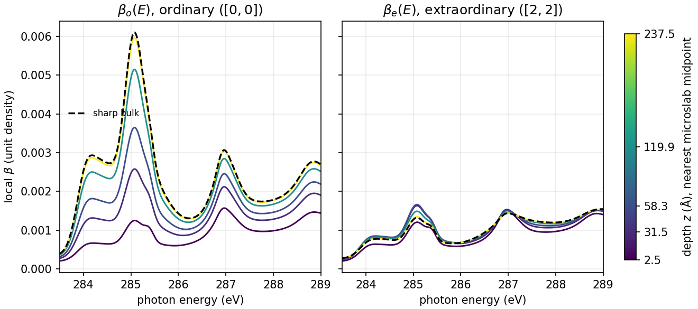
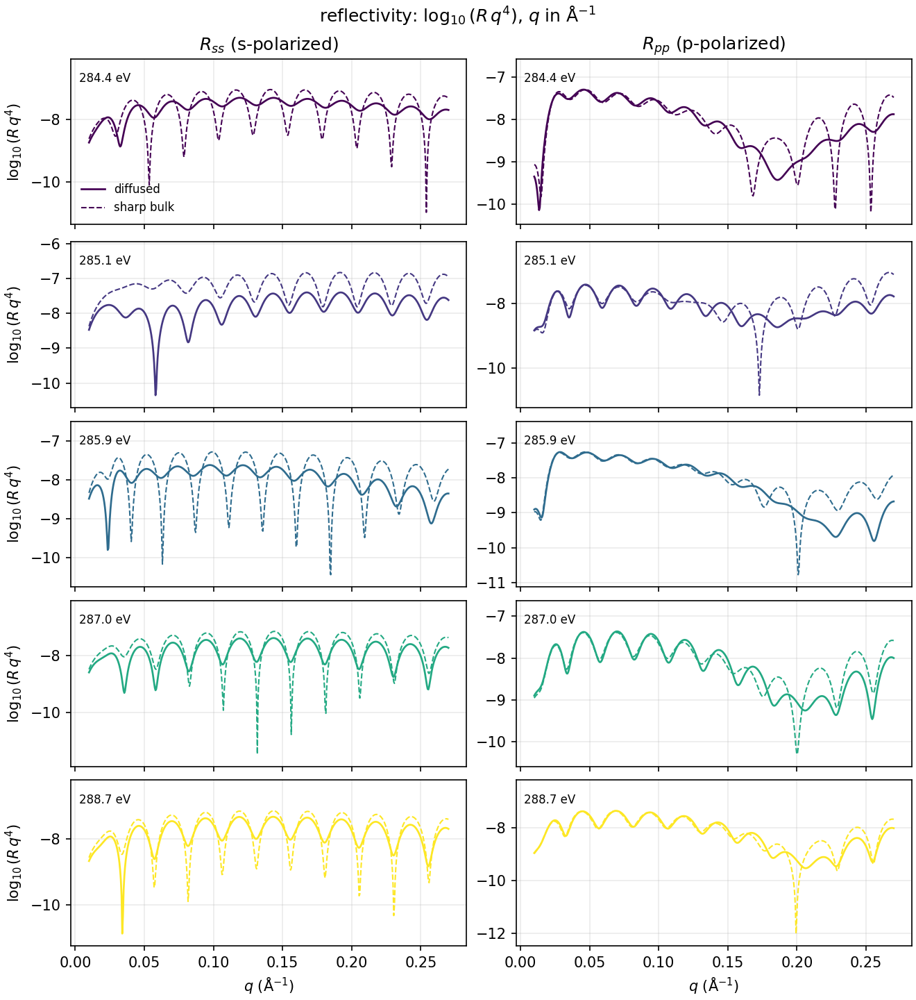
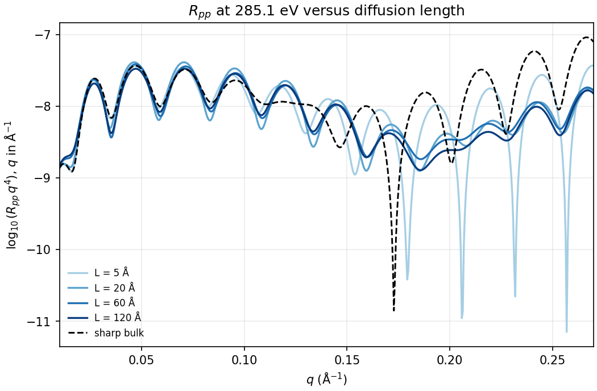

# Surface diffusion

A single-slab film whose optics vary with depth. One material, one
`DepthProfile`, no `Mix`. The orientation, the density and the strength of the
$\pi^*$ peaks all relax from their surface values to their bulk values with
the same exponential diffusion profile.

For the pieces and their conventions, see the
[Lineshapes integration overview](index.md). For the three-material film
with depth-varying composition, see [Peak gradients](peak_gradients.md).

**Example:** `examples/lineshape_surface_diffusion.py`

## The single-slab approach

The film is one `PeakSumSLD` (the full ZnPc tensor, with its frozen peaks and
baseline) inside one `DepthProfile`. There is no `Mix`, so there is no volume
fraction to vary. Each varying quantity is a depth field:

- on the slab, for the orientation `gamma` and the `density_scale`;
- on a peak parameter, for the `height` and `tdm_tilt` of a peak.

Any depth field can be bound to a peak parameter. The example uses `Diffusion`,
but `SecondOrderTransition` and the other depth fields work the same way, not
only `LevelField`.

## The exponential diffusion

`Diffusion(thickness, kind="exponential", edge=..., base=..., length=...)`
evaluates

$$
f(z) = b + (e - b)\,\exp\!\left(-\frac{z}{L}\right),
$$

where

- `edge` ($e$) is the value at the surface, $z=0$;
- `base` ($b$) is the bulk value that the profile relaxes to;
- `length` ($L$) is the $1/e$ depth, in Å.

The example uses $L = 60$ Å in a 250 Å film. At $z=L$ the change is $1/e$ of
the way done. At $z=3L=180$ Å, about 95 % of it is done. The rest of the film
is close to bulk.

The `length` is a refnx `Parameter`, bounded below by $10^{-6}$. If one
`Parameter` is passed to several `Diffusion` fields, they all use it. So one
fit parameter drives every channel:

```python
from refnx.analysis import Parameter

diffusion_length = Parameter(60.0, name="diffusion_length", bounds=(1e-6, None))
```

`parameters.flattened(unique=True)` lists this parameter once.

## Surface and bulk values

Each channel goes from its surface value (`edge`) to its bulk value (`base`).
The $\pi^*$ peaks are the ZnPc peaks with energy below 286 eV. The four
strongest by $F_{\rm iso}$ get a height diffusion. The strongest of them, p3 at
285.06 eV, also gets the TDM tilt diffusion. The bulk tilt is the value derived
from the film anisotropy, as in the [three-material example](peak_gradients.md#znpc-the-full-uniaxial-tensor).

| Channel | Surface (z = 0) | Bulk (z = T) |
|---|---|---|
| orientation $\gamma$ | `MAGIC_ANGLE`, 54.7° | $\gamma_{\rm ref}$, 73.5° |
| `density_scale` | 0.60 | 1.00 |
| p3 height (285.06 eV) | $5.99\times10^{-4}$ (0.35×) | $1.71\times10^{-3}$ |
| p2 height (284.40 eV) | $3.07\times10^{-4}$ (0.35×) | $8.76\times10^{-4}$ |
| p4 height (285.28 eV) | $2.92\times10^{-4}$ (0.35×) | $8.34\times10^{-4}$ |
| p1 height (284.03 eV) | $2.22\times10^{-4}$ (0.35×) | $6.34\times10^{-4}$ |
| p3 TDM tilt $\theta$ | 35° | 4.4° |

The heights are absolute values in unit-density $\beta$, as in the other
examples. Every other peak is constant at its bulk height and tilt. Each
diffusion has $L = 60$ Å.

The film is 250 Å thick, with 60 microslabs on the default adaptive mesh. It
sits on a 15 Å native SiO$_2$ layer on silicon, with 3 Å roughness at each
buried interface. The film's own roughness is 0.

**All of these values are illustrative.** That includes the surface factors
0.35 and 0.60, the 35° surface tilt, the 60 Å length, the 250 Å thickness and
the 15 Å oxide. They are not fitted or measured.

## Construction code

The construction code needs these imports, which put the shared helpers on
the path:

```python
from __future__ import annotations

from typing import Any

import numpy as np
from refnx.analysis import Parameter

from refloxide.lineshapes import MAGIC_ANGLE, Peak, PeakSumSLD
from refloxide.model import MaterialSLD, ReflectModel, Structure
from refloxide.profiles import DepthProfile, Diffusion

# examples/lineshape_materials.py, shared by the lineshapes examples
from lineshape_materials import (
    DENSITY_ZNPC,
    PI_STAR_MAX_EV,
    baseline_table,
    load_materials,
    znpc_iso,
    znpc_tilts,
)
```

The example puts its own directory on `sys.path` for that import. Run the
block as the example module, not pasted into a bare session.

```python
--8<-- "examples/lineshape_surface_diffusion.py:construction"
```

`build_structure(length)` returns the diffused film with the given diffusion
length. `build_reference()` returns the sharp reference: the same film with
every `Diffusion` replaced by its bulk number, a uniform slab with scalar peak
parameters.

Changing the shared length moves every channel together. The next snippet
sets the length to 20 Å and evaluates the orientation at 60 Å. The orientation
moves closer to its bulk value, since the profile relaxes faster:

```python
structure = build_structure(length=60.0)
film = structure[1]
length = next(
    p for p in film.parameters.flattened(unique=True) if p.name == "diffusion_length"
)
length.value = 20.0
gamma_60 = film.named_values_at(np.array([60.0]))["orientation"][0]
```

The reflectivity of the diffused and the reference film comes from one
`ReflectModel` call each. `.s` and `.p` hold $R_{ss}$ and $R_{pp}$, with shape
`(len(q), n_E)`:

```python
q = np.linspace(0.01, 0.27, 200)  # 1/Angstrom
energies = np.array([285.1, 287.0])  # eV
refl_diffused = ReflectModel(build_structure())(q, energies)
refl_reference = ReflectModel(build_reference())(q, energies)
r_ss, r_pp = refl_diffused.s, refl_diffused.p
```

## Figures

Each channel's depth profile. The top row is orientation $\gamma$ and the
density scale. The bottom row is the four $\pi^*$ heights and the TDM tilt of
p3. Dashed lines are bulk values. The dotted line is $z = L = 60$ Å, and the
shaded band is $z < L$.



The local $\beta_o(E)$ (left) and $\beta_e(E)$ (right) of the diffused film,
from 283.5 to 289 eV. Colour is depth, at the microslab nearest 2, 30, 60, 120
and 240 Å. Those microslabs are centred at 2.5, 31.5, 58.3, 119.9 and 237.5 Å,
so the colour bar shows the actual midpoints. The thick black dashed line is
the sharp bulk film.



$R_{ss}$ (left) and $R_{pp}$ (right), as $\log_{10}(R\,q^4)$ against $q$ in
Å$^{-1}$, at five energies: one row per energy, from 284.4 to 288.7 eV. Solid
lines are the diffused film. Dashed lines are the sharp bulk film, in the
row's colour.



$R_{pp}$ at 285.1 eV, as $\log_{10}(R\,q^4)$ against $q$ in Å$^{-1}$, for
diffusion lengths $L$ = 5, 20, 60 and 120 Å in a sequential blue scale. The
black dashed line is the sharp bulk film.



## What the figures show

In the depth-resolved NEXAFS, the local $\beta_o(E)$ at 285.1 eV rises with
depth, from about $1.2\times10^{-3}$ at 2.5 Å to within a few percent of the
bulk value near 240 Å. At 287.0 eV the local $\beta_o$ rises the same way. The
local $\beta_e(E)$ is not monotone with depth at 285.1 eV. It peaks near 50 Å,
at about $1.7\times10^{-3}$ against a bulk value of $1.3\times10^{-3}$, and
then relaxes toward bulk. When each channel is diffused alone, $\beta_e$ is
largest at one of the two faces of the film. The interior maximum appears only
when the channels are combined. This example does not isolate its cause.

In the reflectivity, the diffused film departs from the sharp film most at
285.1 eV in $R_{ss}$, where the sharp film's fine oscillations are damped and
the curve sits lower across most of $q$. At 287.0 and 288.7 eV the two $R_{ss}$
curves are closer. $R_{pp}$ agrees with the sharp film at low $q$, below about
0.13 Å$^{-1}$, and differs at higher $q$, with the largest differences at 285.9
and 287.0 eV.

In the length scan, the curves for different $L$ agree at low $q$ and separate
above about 0.13 Å$^{-1}$. The $L$ = 5 Å curve keeps the deepest and narrowest
minima. The 60 and 120 Å curves are close to each other and smoother. The
sharp bulk film lies above the diffused curves at the highest $q$.
